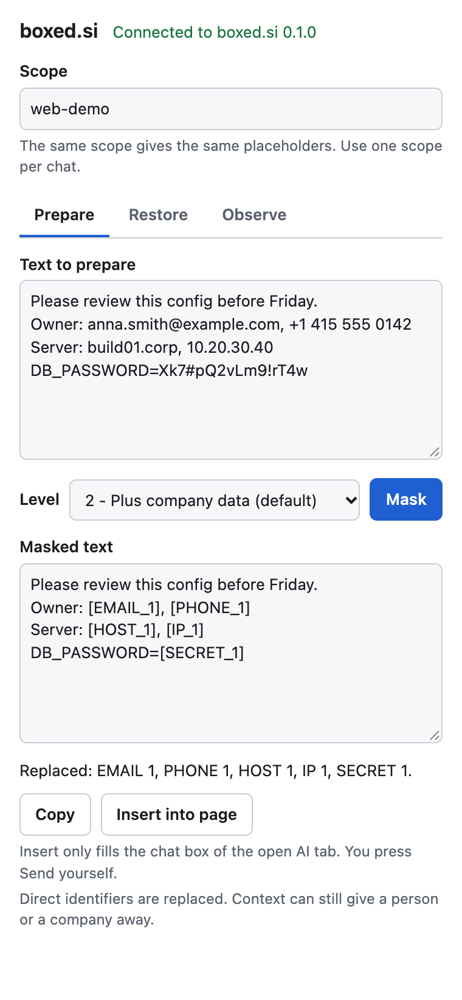

# Browser extension (experimental)

A side panel for Chrome and Edge. You paste text into the panel, the `boxed` program on your computer masks it, and you send the masked text to an AI chat yourself. You paste the chat's answer back into the panel, and the originals come back there, never in the web page. The panel can also count what you send to a chat without masking (Observe, off by default) and keep your notes about each chat's training settings.

**Status: experimental alpha.** No external security audit, not published in any extension store (you load it unpacked), used mostly on macOS. Treat it as a convenience that cuts down mistakes, not as protection you can rely on. Read the masked text before you send it.



boxed prints full paths; this guide shortens your home folder to `~`.

## What it does and what it does not

It does:

- mask the text you put into the panel, on your computer, through the `boxed` program (native messaging);
- fill the focused chat box of the active tab with the masked text when you press **Insert into page** (it never presses Send);
- restore the originals in an answer you copied and pasted into the panel;
- when you turn Observe on, read the text of each message you send to the five chats below and show what kinds of personal data and secrets were in it;
- keep the training-settings notes you write down for each chat and account.

It does not:

- mask anything you type or paste into a chat page yourself, files, images or voice;
- block, delay or change any request (it has no permission to);
- read your chat history, the answers in the page, cookies or request headers;
- send anything to boxed.si or any other server: there are no boxed servers. The extension code contains no `fetch`, XHR or WebSocket, and a test fails if one appears;
- make text anonymous. Direct identifiers are replaced; context can still give a person or a company away.

## Supported browsers and sites

- **Browsers:** Google Chrome and Microsoft Edge, version 116 or later. `boxed install native-host` registers the host for these two only; Chrome Beta, Canary, Chromium, Brave and others are not registered and will not connect.
- **Systems:** macOS. Windows 11: the host registration exists (it writes to your user's registry, no administrator rights) and is covered by tests, but the panel has seen little use there. Linux: not supported yet: `boxed install native-host` refuses there with `boxed install native-host works on macos and windows only` and writes nothing.
- **Chats:** ChatGPT (`chatgpt.com`), Claude (`claude.ai`), Gemini (`gemini.google.com`), DeepSeek (`chat.deepseek.com`) and Z.ai (`chat.z.ai`). Insert into page and Observe work only there. Copy works with any chat.

## Install

1. Install boxed (Python 3.13), see [install.md](install.md). The extension can do nothing without it.
2. Find the extension folder. In a clone of the repository it is `extension/`. With boxed installed as a package, run `boxed install native-host` without an id: the line above the error names the folder that ships inside the package:

   ```text
   $ boxed install native-host
   extension folder to load unpacked: ~/.local/share/uv/tools/boxedsi/lib/python3.13/site-packages/boxed/_extension
   boxed: error: native-host needs --extension-id: load the extension folder above unpacked in the browser, then copy its id
   ```

3. Open `chrome://extensions` (or `edge://extensions`), turn on **Developer mode**, press **Load unpacked** and pick that folder. In the macOS file dialog, press Cmd+Shift+G and paste the path if the folder is hidden.
4. Copy the extension id the browser shows on the card (32 letters from a to p).
5. Register the native host. `--dry-run` shows what would be written and writes nothing:

   ```text
   $ boxed install native-host --extension-id <id>
   wrote: ~/Library/Application Support/Google/Chrome/NativeMessagingHosts/si.boxed.host.json
   wrote: ~/Library/Application Support/Microsoft Edge/NativeMessagingHosts/si.boxed.host.json
   extension folder to load unpacked: ~/.local/share/uv/tools/boxedsi/lib/python3.13/site-packages/boxed/_extension
   ```

   It also writes the launcher. On macOS it is always `~/.boxed/bin/boxed-native-host`, even when you set `BOXED_HOME`, and it passes your `BOXED_HOME` to the host. On Windows it is `%LOCALAPPDATA%\boxed\native-host\boxed-native-host.cmd`. The host manifest allows only this one extension id.
6. Click the boxed.si button in the toolbar (pin it from the puzzle-piece menu if you do not see it). The panel opens and says `Connected to boxed.si 0.1.0`.

Chrome derives the id of an unpacked extension from its folder path. A new folder (for example after you reinstall boxed with another Python) means a new id: load the folder again and register again. Run step 5 again too when boxed moves to another Python environment, because the launcher names the Python that was in use.

If the panel does not connect, it shows one fixed sentence:

| The panel says | What to do |
|---|---|
| The boxed.si program is not registered with this browser. Run: boxed install native-host --extension-id ... | Run that command. |
| The boxed.si program does not trust this extension yet. Run: ... | The id changed. Run the command with the new id. |
| The boxed.si program exited before it answered. Reinstall it, then try again. | The launcher could not run, for example because boxed moved. Register the host again; reinstall boxed if that does not help. |
| The boxed.si program cannot start. Check keychain access and boxed.toml. | Allow keychain access. Fix `~/.boxed/boxed.toml` if you have one. |
| The boxed.si program failed. Nothing was prepared. | Try again. The class name of the error is in `host-errors.log` in the boxed folder. |
| Could not reach the boxed.si program. | Check that `boxed` is installed and the host is registered. |

## Prepare: mask and send

1. Open the chat in the active tab.
2. Check the **Scope**. The same scope gives the same placeholder for the same value, so use one scope per chat. Before your first Mask it is `web-YYYYMMDD` (the UTC date); after that the panel keeps the scope of your last Mask until you change it. Letters, digits, dot, dash and underscore, up to 64 characters.
3. Pick the **Level**, paste your text under **Text to prepare** and press **Mask**.
4. Read the **Masked text**. Under it the panel says what it replaced, for example `Replaced: EMAIL 1, SECRET 1.`, or `Nothing found to replace. Read the text yourself before you send it.`
5. Press **Copy**, or click into the chat box and press **Insert into page**. Then press Send in the chat yourself.

| Level | Label in the panel | What is replaced |
|---|---|---|
| 0 | Secrets only | Keys, passwords, tokens, private keys, card numbers |
| 1 | Secrets and personal data | Plus people, e-mail addresses, phone numbers, IP addresses, IBAN, Russian tax and insurance numbers |
| 2 | Plus company data (default) | Plus internal hosts and URLs, companies and the terms of your dictionary |

An internal host ends in `.internal`, `.local`, `.lan`, `.corp` or `.intranet`, or in a domain you list as `internal_domains` in `boxed.toml`. Names and companies are found only with a name model or your dictionary. Levels 3 and 4 are command-line only (see [concepts.md](concepts.md)). The panel reads its settings only from `~/.boxed/boxed.toml` (or `$BOXED_HOME`), because a browser gives the program no project folder (see [configuration.md](configuration.md)). Each Mask writes a journal record (`extension`, `prepared`) with kinds and counts, never the text.

## Restore: put the originals back

1. Copy the answer with the chat's own Copy button.
2. In the panel, open **Restore**, paste the answer, check that the **Scope** is the one you masked with, and press **Restore**.
3. Read the **Restored text** and press **Copy**.

Restore never guesses. A placeholder boxed does not know, or one the model changed, is listed under **Check by hand** and left as it is; the button then reads **Copy anyway**. The panel and the command line share one vault: a text masked in the panel can be restored with `boxed restore --scope web-20261024`, and the other way round. Each Restore writes a journal record (`extension`, `received`).

## Observe: what it records and what it never records

Observe is off until you switch on **Observe sends** on the **Observe** tab. It is a report to you, not protection: the message has already gone when the line appears. If a key or password was in it, revoke and replace it.

While it is on, the background worker watches the one request each chat uses to send a message. It reads the text of your message from the request body and hands it to the `boxed` program, which searches it at level 2 and answers with kinds and counts. Only a POST made with fetch or XHR by the chat's own page counts; a request started by another site is ignored. The panel lists the last 20 sends:

```text
10:41:07 claude: EMAIL 1, SECRET 1
10:44:52 chatgpt: nothing found
10:47:30 gemini: not checked (not readable or too large, or the boxed.si program was too slow or busy)
10:51:12 deepseek: not recorded (the boxed.si program did not answer)
```

**What is recorded:**

- By the program, in `observed.jsonl` in the boxed folder: the site, the time, the kinds and counts, whether the text was checked, and a keyed hash (HMAC-SHA256 with a key kept in boxed's key store) of the text. The hash cannot be matched to the provider's logs. The file is a signed chain of its own and is not part of `boxed journal export`; `boxed dashboard` shows it as "Sent without boxed" (see [dashboard-and-journal.md](dashboard-and-journal.md)).
- By the browser: the switch (`chrome.storage.local`), and the site, time, counts and coverage of the last 20 sends (`chrome.storage.session`, gone when the browser closes).

**What is never recorded:** the text of the message, the address of the request or any conversation id in it, request headers and cookies, your chat history, the answers, and attachments.

**Coverage.** `checked` means the text was read and searched. `not checked` means it was not: an unexpected body shape, no text, text that is not valid Unicode, a body over 900,000 bytes, no answer from the program in 20 seconds, or 5 sends already waiting. "Nothing found" is a best-effort answer, not proof that a message is clean.

**Not checked at all:** files and images you attach (they travel in other requests), traffic over WebSocket, and anything you send from a site other than the five.

**While it is off.** The browser still wakes the worker for every fetch or XHR request to the five chats and hands it the request details, the body of a POST included; Chrome does this for any extension that asks to see request bodies, and a Manifest V3 worker must register its listener at start. The worker looks at the address, the method and the sender, finds the switch off and lets the request go: it does not read the body, pass it on or keep it. To stop even that, turn the extension off on `chrome://extensions`.

## Training checks

Chats may train on your conversations unless you turn that off. boxed does not read your account settings: on the **Observe** tab, under **Training on chats**, you write down what each chat's data controls say about training and memory (On, Off or Unknown), per account, and press **Save**. **Open setting** opens the data-controls page of ChatGPT, Claude or Gemini in a new tab. boxed reminds you (**Check again**) after 30 days or while a setting is Unknown. Unknown counts as training. The notes live in `checks.json` in the boxed folder; the same data is on the command line as `boxed check set`, `boxed check list`, `boxed check remove` and `boxed check reset` (see [cli.md](cli.md)). If `checks.json` is damaged, the panel says so and every chat counts as training until you run `boxed check reset`.

## Permissions and why

| Permission | Why |
|---|---|
| `sidePanel` | Shows the panel when you click the toolbar button. |
| `nativeMessaging` | The link to the `boxed` program on your computer. The host manifest allows only this extension's id. |
| `scripting` | Insert into page runs one small function in the active tab, only on the five chats. There is no `activeTab`. |
| `webRequest` | Lets the worker see the fetch and XHR requests of the five chats, for Observe. Watching only: there is no `webRequestBlocking`, so it cannot hold back or change a request. See "While it is off" above. |
| `storage` | The Observe switch and the last 20 results. |
| Hosts: the five chats | What `scripting` and `webRequest` may reach. Nothing else: no `<all_urls>`, no `tabs`, no content scripts. |

Copy writes to the clipboard from your click, so there is no clipboard permission. The panel also remembers the last scope in its own local storage.

**What leaves the browser.** The extension makes no network requests of its own. Text goes only to the `boxed` program on your computer, over native messaging. The only pages it opens are the three data-controls pages, when you press **Open setting**. The host behind the panel does not send your text anywhere either. What boxed as a whole can send, and when, is in [privacy.md](privacy.md).

## The program behind the panel

Mask and Restore keep one connection to the program while you work, so the name models load once, not at every click. It closes after 60 seconds without a request and when you close the panel, and the program ends with it; the first click after a pause is the slow one. A request with no answer after 2 minutes is given up and the program is stopped. The status check, the training checks and Save are single messages. One message is at most 1 MB each way.

Pieces of recent texts can stay in the program's memory until it ends: boxed empties the caches it can reach, but cannot wipe memory Python has already freed. Whoever can read the memory of your processes in that time (a debugger, a core dump) could find them.

When the program fails, it adds one line to `host-errors.log` in the boxed folder: the time, "host cannot start" or "internal error", and the error class. Never the message, a traceback or your text. The file is private (mode 600) and at most 64 KiB.

## Known limits and what is not verified

- **No audit.** The extension and the host have had no external security review.
- **The send shapes are guesses.** Observe recognises each chat's send request by its address and body. Those shapes come from public knowledge of the sites, not from a contract, and were not re-checked on the live sites for this release. When a site changes them, the list shows `not checked`, or no line at all.
- **Insert into page** fills the focused box with standard input events (`execCommand("insertText")` for rich editors). A chat that rebuilds its editor can ignore it; then use Copy.
- **After Insert, the page's scripts can read everything shown in Masked text**, before you press Send, including values the detectors missed or the selected level left visible. Review the preview before you insert it. The originals of the placeholders stay on your computer.
- **Text only, levels 0 to 2 only.** Files and images are not masked.
- **Windows** is lightly used; **Linux** and Chromium browsers other than Chrome and Edge are not supported.
- **Unpacked install only.** No store listing and no automatic updates: after you update boxed, press the reload button on the extension's card.

## Remove it

1. On `chrome://extensions` (or `edge://extensions`), press **Remove** on the boxed.si card. The browser deletes the switch and the stored results with it.
2. Remove the host registration: `boxed install native-host --remove` (add `--dry-run` first to see the list). It deletes both `si.boxed.host.json` files and the launcher, or on Windows the registry keys and the host folder. It does not touch your boxed folder.
3. Your boxed folder keeps `observed.jsonl`, `checks.json`, the journal and the vault. To remove boxed entirely, see [install.md](install.md).
