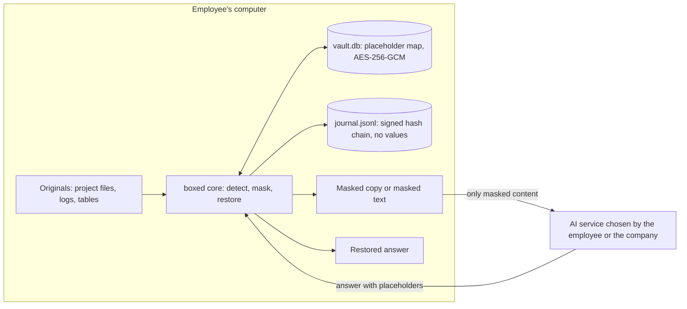

# Data flows

| Data | Leaves the device | Stored where | Who can read it |
|---|---|---|---|
| Originals | No | Where they already are | The employee, as before |
| Masked text or file | Yes, to the chosen AI service | At the AI service, under its terms | The AI service |
| Placeholder map | No | `vault.db`, encrypted | The employee's account through the OS keychain |
| Journal records | Only if the employee exports them | `journal.jsonl` | The employee; the security team when given an export |
| API key | Only to the provider, or to the relay the employee names, as the request header | OS keychain, or the provider's environment variable | The employee's account |
| Observation records (kinds, counts, a keyed hash) | No; not in the journal export | `observed.jsonl` | The employee |
| Training checks | No | `checks.json` | The employee |
| Audit and dashboard reports | Only if shared | `~/.boxed/reports/` | The employee |
| Record of the last extension check: ids, places, digests, verdicts, rule ids with file and line | No | `~/.boxed/skills/record.json` | The employee. No evidence text and no value from a config; of a model's finding (`--ai`) only its rule, severity, file and line |
| Quarantined agent extensions | No | `~/.boxed/skills/quarantine/<id>/` | The employee. It can hold the `env` and header values of a config entry, and `original`: a full copy of each config file boxed edited, as it was before, with the values of its other entries, until restore |
| Masked text of extension files with findings (`boxed skills scan --ai` only) | Yes, to the chosen AI service | At the AI service, under its terms | The AI service |
| Skills reports (`--html`, `--json`) | Only if shared | A place the employee names, never `~/.boxed` | The employee |

## Channels

| Channel | How masked content reaches the AI service | Who presses "send" |
|---|---|---|
| AI coding agents (Claude Code, Codex) | The agent works in a masked copy of the project; edits sync back with originals restored | The agent, inside the masked copy |
| Text by hand | `boxed mask` output is pasted into the chat | The employee |
| Browser side panel | The panel masks the text and inserts it into the AI page | The employee |
| API key (OpenAI, Anthropic, DeepSeek, OpenRouter) | `boxed ask` checks the policy, masks the prompt, writes the journal record, sends the masked text with the key and restores the answer locally | boxed, after the policy allows it and the record is written |
| Browser observation (off by default) | Nothing is sent: the extension counts, by kind, what the employee sends without boxed | The employee; boxed never touches that send |
| Extension check with `--ai` (off by default) | `boxed skills scan --ai` hands the files of agent extensions that have findings of the rules to a model, through the steps of `boxed ask`: the policy decides, the text is masked at level 1, the `sent` record is written, the request goes out, the `received` record is written | boxed, after the policy allows it and the record is written |

### The API channel

One request per prompt, no streaming, in the provider's own shape: OpenAI Responses (`store: false`: the response is not stored for later retrieval, but OpenAI may still keep abuse-monitoring logs for up to 30 days), Anthropic Messages, and chat completions for DeepSeek and OpenRouter. The order is fixed, and each step comes before the next: the policy decides; the prompt is masked; the `sent` record is written; the request goes out; the answer is restored and the `received` record is written. If the policy says deny or local-only, or a record cannot be written, no request is made. What the provider sends back is not trusted: an error names the provider, the HTTP status and a word from a fixed list, and an answer gets back only the placeholders of its own prompt. A redirect is never followed, so the key header stays with the address the employee named.

OpenRouter requests carry `data_collection: deny`, and `zdr: true` when the account type is `api-zero-retention`, so that only endpoints without retention are used; they also ask for usage accounting, and the cost OpenRouter reports is journaled as `cost_micro_usd`. For the other providers zero retention is an agreement on the account, which boxed cannot ask for per request. A relay set in `BOXED_<PROVIDER>_BASE_URL` receives the masked prompt and the key; such sends are marked `relay` in the journal, and boxed says so on stderr when it makes the request. An address on the same computer is never handed to a proxy from the environment (the proxy would see the key and the prompt); a remote one follows `HTTPS_PROXY`. Level 4 is not a prompt level: it is the task and the table schema only, which `boxed plan` builds, so `boxed ask` refuses it, and a policy rule that needs level 4 blocks the send.

### The extension check

`boxed skills scan` reads the folders where the agents on the computer load extensions, and the folder, file, zip or address the employee names. It runs nothing, follows no link inside what it reads and uses no network. The session warning (`boxed hook skills-check`) uses none either. The one exception is a git address, or `owner/repo`, given as a target: boxed runs `git clone` over https only, to depth 1, without submodules, git hooks or git configuration, within 120 seconds, into a private temporary folder that is removed afterwards. The request carries no file of the employee.

With `--ai` the files of an item that have at least one finding of the rules go out, in requests of at most 100 KiB. The order is that of `boxed ask`: the policy of the `boxed.toml` found from the current folder decides first (deny and local-only send nothing), the text is masked at level 1 or higher (secrets, personal data and IP addresses become placeholders; host names and URLs stay readable, or the model has nothing to judge), the `sent` record is written, then the request goes out. A file name or a path is never sent, only an alias (`file-1`), and neither is a config entry, the config file of an agent (settings, MCP, hooks and Codex config files, plugin manifests, whose values stay home even when the file has findings), a file over 100 KiB or a file that is not UTF-8 text. Before the request boxed prints how many files and about how many tokens go where. The answer must be strict JSON, a finding counts only when its quote occurs in the file, and a finding can only be added: nothing in the answer removes or lowers a finding of the rules. The same file text (SHA-256), provider and model are not sent twice. The API key and the relay rules are those of `boxed ask`.

## Files and tables

boxed never sends or patches a source file: it builds a new file from what it checked and names what it left out. "complete: no" means something that could hold data was left out.

| Format | Checked | Named as left out |
|---|---|---|
| CSV | All cells | - |
| XLSX | Values of the visible sheets | Hidden and very hidden sheets, hidden rows and columns, comments, images and charts, defined names, data validation, external links, pivot tables, hyperlink targets, print headers and footers, formulas without a cached result; a sheet name that had to change to fit Excel (forbidden characters, over 31 characters, a duplicate) |
| DOCX | Body, tables, headers and footers of the first section | Comments, tracked changes, hidden text, images and embedded objects, footnotes, endnotes, content controls, headers and footers of later sections, text in fields, smart tags and equations (also in headers and footers), hyperlink targets |
| PDF | The text layer | Images, annotations, attachments, document properties; a PDF is never complete |

Three things are named but do not make a copy "incomplete": document properties (author, title and the like) and character formatting, because nearly every Office file has them and the copy carries none of them, and formulas whose cached result was kept, because the value a reader sees was checked.

`boxed plan` refuses a table of more than 5,000,000 cells (rows times columns), before it builds a prompt or runs a plan, so that one plan cannot use unbounded time or memory.

## Recipients and jurisdictions

The policy combines a data category (secrets, personal data, clients, finance, code, strategy, HR, health) with a recipient (personal account with or without training on chats, company plan, API with zero retention, local model). The answer is "allow", "masked at level N or higher", "local only" or "deny". boxed shows the recipient's jurisdiction and warns when personal data would leave the EEA: masking does not replace a legal basis for the transfer.
